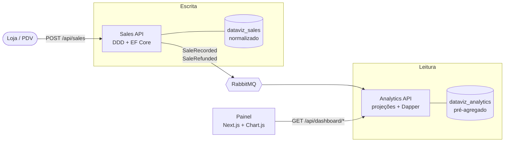

# DataViz Dashboard

Painel de vendas em tempo quase real: um serviço registra as vendas, outro constrói as tabelas que o painel consulta, e os dois só se falam por eventos. Backend em **.NET 8**, frontend em **Next.js 14** com **Chart.js**, tudo orquestrado com **Docker Compose**.

O projeto existe para mostrar **CQRS com modelos de escrita e de leitura fisicamente separados**: bancos diferentes, tecnologias de acesso diferentes e consistência eventual entre eles.

## Como funciona



1. O **Sales** valida a venda no agregado `Sale`, grava no seu banco e, na mesma transação, coloca o evento na *outbox*.
2. Um publicador entrega o evento ao RabbitMQ.
3. O **Analytics** consome o evento e atualiza duas tabelas: `sales` (uma linha por venda) e `daily_sales` (totais por dia, loja, categoria e canal).
4. O **painel** consulta só o Analytics e se atualiza sozinho a cada 5 segundos.

Uma venda registrada aparece no painel em cerca de um segundo. Esse atraso é a consistência eventual, e é o preço de cada lado poder ser modelado para o seu trabalho.

## Por que separar escrita e leitura

| | Lado de escrita (Sales) | Lado de leitura (Analytics) |
|---|---|---|
| Pergunta que responde | "Essa venda pode ser registrada? Pode ser reembolsada?" | "Quanto vendemos por dia, por canal, por loja?" |
| Modelo | Agregado `Sale` com invariantes | Tabelas desnormalizadas e pré-agregadas |
| Acesso a dados | EF Core, com rastreamento de mudanças | Dapper, SQL escrito à mão |
| Esquema | Migrações do EF Core | Script SQL idempotente |
| Pode ser reconstruído? | Não, é a fonte da verdade | Sim, reprocessando os eventos |

O gráfico de receita é um `GROUP BY` sobre algumas centenas de linhas de `daily_sales`, não importa quantas vendas existam. E o serviço de vendas não carrega nenhum índice ou coluna que só serve a relatório.

## Decisões de projeto

**Clean Architecture.** No Sales, as dependências apontam para dentro: `Domain` ← `Application` ← `Infrastructure` ← `Api`. O Analytics não tem camada de domínio de propósito: ele não decide nada, só projeta e consulta, e inventar agregados ali seria cerimônia.

**DDD onde há regra.** `Sale` não aceita valor zero nem data futura, só é reembolsada uma vez e apenas dentro de 30 dias. As regras estão no agregado e são testadas sem banco.

**Eventos autossuficientes.** `SaleRecorded` carrega nome da loja, categoria, canal e valor. O Analytics nunca chama o Sales de volta para entender um evento, então um serviço pode cair sem derrubar o outro.

**Projeções idempotentes.** A entrega do broker é *at-least-once*. Cada evento é aplicado em uma transação junto com o registro do seu id em `processed_events`; se o mesmo evento chegar de novo, nada muda.

**Transactional outbox.** O evento é gravado na mesma transação da venda e publicado depois, então não existe venda salva sem evento.

**Dia de negócio.** A venda cai no dia do fuso da operação (`America/Fortaleza`, configurável), não no dia UTC. Uma venda às 22h não vai parar no dia seguinte.

**Indicadores com definição única.** Receita líquida, ticket médio e taxa de reembolso são calculados em `PeriodTotals`, e a comparação com o período anterior em `Indicator`, ambos cobertos por testes.

## Como rodar

Pré-requisito: Docker.

```bash
docker compose up -d --build
```

| Endereço | O que é |
|---|---|
| http://localhost:3100 | Painel |
| http://localhost:8081/swagger | Sales API (escrita) |
| http://localhost:8082/swagger | Analytics API (leitura) |
| http://localhost:15673 | Painel do RabbitMQ (`dataviz` / `dataviz`) |

Na primeira subida, um gerador de demonstração cria 60 dias de histórico (cerca de 6.500 vendas; leva perto de um minuto) e continua vendendo no mesmo ritmo dos dias anteriores, uma venda a cada poucos minutos em horário comercial. O ritmo é proposital: um gerador mais rápido faria o dia de hoje esmagar o resto do gráfico. Todas passam pelo mesmo comando que um cliente real usaria. Para subir sem dados de demonstração:

```bash
DEMO_ENABLED=false docker compose up -d --build
```

Registre uma venda e veja o painel reagir (pegue o id de uma loja em `GET http://localhost:8081/api/stores`):

```bash
curl -X POST http://localhost:8081/api/sales -H "Content-Type: application/json" -d '{"storeId": "<STORE_ID>", "category": "Electronics", "channel": "Online", "amount": 2499.90}'
```

## API

**Sales (escrita)**

| Método | Rota | Descrição |
|---|---|---|
| `POST` | `/api/sales` | Registra uma venda. `occurredAtUtc` é opcional, para envio atrasado |
| `POST` | `/api/sales/{id}/refund` | Reembolsa uma venda |
| `GET` | `/api/stores` | Lojas cadastradas |

Categorias: `Electronics`, `Fashion`, `Home`, `Beauty`, `Sports`, `Grocery`. Canais: `InStore`, `Online`, `Marketplace`.

**Analytics (leitura)** — os endpoints de período recebem `from`, `to` (`AAAA-MM-DD`) e `storeId` opcional.

| Método | Rota | Descrição |
|---|---|---|
| `GET` | `/api/dashboard/summary` | Indicadores do período, comparados com o período anterior |
| `GET` | `/api/dashboard/revenue` | Receita líquida e pedidos por dia |
| `GET` | `/api/dashboard/breakdown?dimension=` | Receita por `category`, `channel` ou `store` |
| `GET` | `/api/dashboard/recent-sales?limit=` | Últimas vendas |
| `GET` | `/api/dashboard/stores` | Lojas com vendas, para o filtro |

## O painel

- Cada gráfico tem a forma que a pergunta pede: linha para evolução, barras ordenadas de uma cor só para comparar magnitudes, barra segmentada para as três fatias de canal. Nenhum eixo duplo.
- As cores de série vêm de uma paleta validada para daltonismo, e a cor segue o canal, não a posição no ranking.
- Todo valor é legível sem passar o mouse; o gráfico de linha tem uma tabela equivalente para leitores de tela.
- Temas claro e escuro pelo `prefers-color-scheme`, com os tons de cada série escolhidos para cada fundo.
- O navegador fala apenas com o próprio Next.js, que repassa as chamadas ao Analytics. Sem CORS e sem expor o endereço do serviço.

## Testes

```bash
dotnet test backend/DataViz.sln
```

```bash
npm --prefix web run typecheck
```

## Estrutura

```
backend/
├── src/
│   ├── BuildingBlocks/   # Núcleo de domínio, CQRS, outbox e RabbitMQ
│   ├── Sales/            # Domain · Application · Infrastructure · Api
│   └── Analytics/        # Application · Infrastructure · Api
└── tests/
web/                      # Next.js 14 + TypeScript + Chart.js
deploy/postgres/          # Criação dos dois bancos
docker-compose.yml
```

## Fora do escopo

Autenticação, reconstrução automática do modelo de leitura a partir do histórico de eventos (hoje exigiria republicar a outbox), e atualização por push (o painel faz *polling*).
